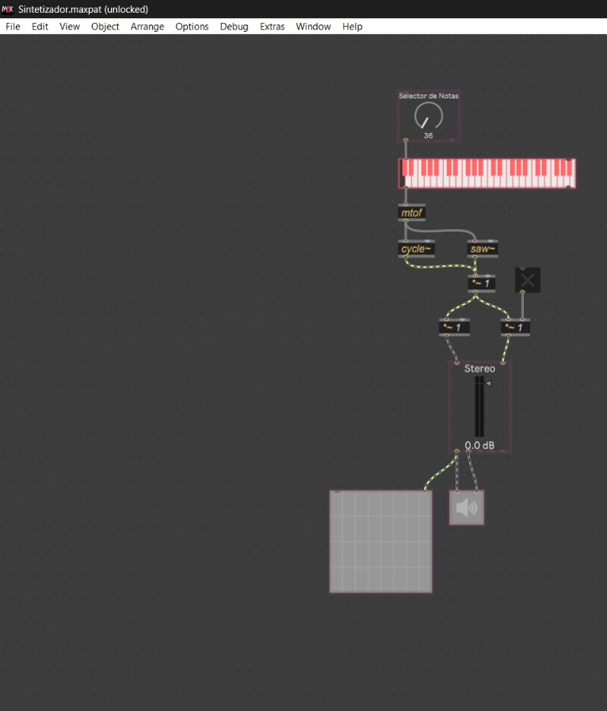
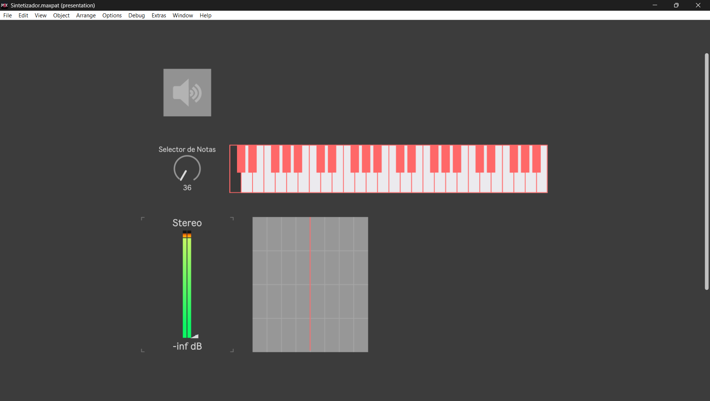

# Proyecto 03 | Sintetizador Digital e Interfaz Interactiva en Max/MSP

Este repositorio contiene la documentación y el desarrollo completo del proyecto 3 para el **Taller de Interfaces**.

## Descripción del Proyecto

Desarrollo de un sintetizador de audio digital e interfaz interactiva en tiempo real diseñado en el entorno Max/MSP. El sistema combina controles gráficos y parámetros de síntesis sonora con retroalimentación visual, priorizando la claridad operativa y la usabilidad. Funciona mediante síntesis digital interna con osciladores dedicados, operando de forma autónoma sin requerir archivos o muestras de audio externas.

## Registro

### Demostración en Video

[Video YouTube | Sintetizador Virtual](https://youtu.be/L7ei7VBB9Hc)

### Registro del Proceso e Interfaz

| Modo Edición | Modo Presentación |
| :---: | :---: |
|  |  |

* **Modo Edición:** Vista del parche de trabajo en Max/MSP durante el desarrollo y cableado de objetos.
* **Modo Presentación:** Vista limpia de la interfaz orientada al uso interactivo y control en tiempo real.

## Estructura del Repositorio

* **`codigosintetizador/`** : Contiene el parche principal de Max/MSP (`Sintetizador.maxpat`).
* **`fotos/`** : Registro visual de la interfaz tanto en modo edición como en modo presentación (`fotos/modo_edición.jpg`) / (`fotos/modo_presentacion.png`).
* **`videofuncionamiento/`** : Carpeta que almacena el respaldo local del video de demostración.

## Tecnologías y Recursos

* **Entorno de Programación:** Max/MSP para el procesamiento de señales digitales (DSP) y síntesis en tiempo real.
* **Componentes y Controles:** Objetos de interfaz gráfica, teclado virtual MIDI, osciladores de control y visualización de ondas mediante `scope~`.
